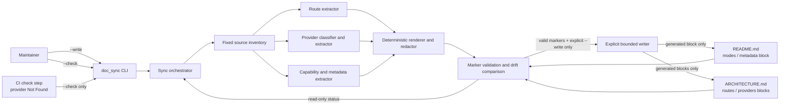

# AG-4 — AiMitra-1 Architecture Proposal

**Status: PROPOSAL — awaiting explicit human approval.**  
This document is not an approved/final architecture. No Design Review or Planning stage has been started.

## 1. Architecture overview and objectives

Extend the repository's existing `scripts.doc_sync` documentation generator into a deterministic, bounded documentation pipeline. It reads only the approved code and verified metadata inputs, renders the README capability section and ARCHITECTURE route/provider tables, and updates only their marked regions when a maintainer explicitly invokes `python -m scripts.doc_sync --write`. A read-only `python -m scripts.doc_sync --check` is the CI gate for detecting drift; CI must never run a write operation.

The architecture prioritizes factual output, preserved hand-authored documentation, actionable failures, and secret exclusion. It does not infer broader product/workspace/tool capabilities or introduce performance targets.

## 2. Requirements and constraints

The approved source of requirements is `.github/AgentOutput/AG-4/requirements.md`:

- Inventory the specified route modules, service modules, frontend capabilities and verified project metadata (FR-001).
- Generate README capability content only from `capabilities.js` and verified metadata (FR-002).
- Generate route and AI-provider tables from the specified backend code. Use the exact value `Not Found` for unknown fields and exclude non-provider services (FR-003, FR-004, BR-002, BR-003).
- Support explicit `--write` and read-only `--check` commands, with CI using only the latter (FR-005, FR-006, BR-005).
- Change only designated generated blocks; reject missing markers (FR-007, FR-008, BR-004).
- Exclude secrets, API keys and `.env` values. Missing/empty input, parse errors, missing markers and stale docs must produce actionable errors and non-zero status, without silently producing incomplete output or overwriting on failure (FR-009, NFR-001–NFR-003, BR-006).
- Performance target: **Not Found** (NFR-004).

The required CLI contract remains `python -m scripts.doc_sync --write` and `python -m scripts.doc_sync --check`. The requirements do not authorize new functional content beyond these generated sections and their documented commands.

## 3. Existing system context (verified)

| Area | Repository evidence and current state |
|---|---|
| Generator entry point | `scripts/doc_sync/__main__.py` provides mutually exclusive `--check`/`--write` options, defaults to check, and returns status from `sync.run`. |
| Extraction | `scripts/doc_sync/extract.py` uses Python AST for route declarations and service modules, and extracts the `CAPABILITIES` array from `frontend/src/utils/capabilities.js`. It confines its reads to those sources, rejects missing/empty Python source folders, reports Python syntax errors, and returns `Not Found` for some unavailable facts. |
| Rendering | `scripts/doc_sync/render.py` renders Markdown tables and includes a redaction pass for known token patterns and secret-like assignments. |
| Synchronization | `scripts/doc_sync/sync.py` targets the `routes` and `services` blocks in `ARCHITECTURE.md`, and `modes` in `README.md`; it detects stale references and compares blocks for drift. |
| Documentation markers | README contains `doc-sync:modes` markers. ARCHITECTURE contains `doc-sync:routes` and `doc-sync:services` markers. Their surrounding prose is outside the generated blocks. |
| Existing route sources | `backend/routes/*.py` contains FastAPI route modules; `health.py` declares an `APIRouter` without an explicit prefix. Route registrations in application setup are outside the extractor's documented fixed inputs, so dynamic/outer prefixes are not assumed. |
| Existing services | `backend/services/` contains the AI-service modules `anthropic_service.py`, `gemini_service.py`, `groq_service.py` and `openai_compat_service.py`, as well as `jira_service.py`, which is a Jira REST API service rather than an AI provider. |
| Frontend capability source | `frontend/src/utils/capabilities.js` defines the `CAPABILITIES` array with mode IDs, labels and descriptions. |
| Metadata | `frontend/package.json` verifies package name `qa-assistant-frontend` and version `1.0.0`. A canonical AiMitra product-metadata source/field set is **Not Found**. These package fields must not be relabeled as verified product identity without an approved basis. |
| Tests | `tests/doc_sync/test_doc_sync.py` contains local temporary-fixture tests for extraction, redaction and sync behavior. `README.md` documents `python -m unittest discover -s tests/doc_sync -t .` and `python -m scripts.doc_sync --check`. |
| CI | `.github/workflows` is **Not Found** (the directory does not exist); no CI provider or workflow configuration was identified in the inspected repository. A platform-specific location cannot be named from current evidence. |
| Existing generator gap | Current `extract_services()` emits every Python module in `backend/services/`, including `jira_service.py`, and the generated ARCHITECTURE table currently contains that non-AI service. The current README generated block is modes-only; project metadata is not currently extracted. Existing sync can also proceed to write changed blocks when another required marker is missing. These behaviors need to be corrected to satisfy the approved scope and failure-safety requirements. |

Existing components listed above are repository facts, not claims that the requirements have already been fully met.

## 4. Proposed architecture

Keep the feature inside the current Python standard-library-based `scripts.doc_sync` package; do not add an application service, network dependency, database, frontend behavior, or third-party parser. Separate responsibilities as follows:

1. **CLI/orchestrator (`__main__.py`, `sync.py`)** — parse mutually exclusive command flags, coordinate the pipeline, print actionable status, and return `0` for success, non-zero for drift/check failure or operational error. `--check` is strictly read-only.
2. **Fixed-source inventory/extractors (`extract.py`)** — read only `backend/routes/*.py`, `backend/services/*`, `frontend/src/utils/capabilities.js`, and an explicitly approved metadata source. Parse Python routes with AST; extract capability entries from the named JS array; identify provider modules without classifying unrelated services. Missing/empty inputs, malformed sources, and unavailable values must be explicit, not guessed.
3. **Metadata reader** — use a deliberately allow-listed, verified project-metadata file/fields only. Current repository evidence supports `frontend/package.json` package name/version, not canonical product identity. Product metadata fields without a verified source render exactly `Not Found`; do not lift marketing claims from existing README prose into generated content.
4. **Deterministic renderers (`render.py`)** — produce only the generated README capability/metadata content and ARCHITECTURE route/provider tables. Escape Markdown cell delimiters, normalize line endings for comparison, render unavailable documented fields as exactly `Not Found`, and apply secret redaction as defense in depth.
5. **Marker validator and bounded writer (`sync.py`)** — read both target documents, validate every required start/end marker before writing either file, and construct all new documents in memory. On missing markers, source errors, or parse errors, stop before any document write. `--write` replaces only block contents; prose outside markers is preserved byte-for-byte as far as the text/encoding handling permits. Use staged writes and safe replacement/rollback handling so a failed write does not silently leave only one document updated.
6. **Read-only CI gate** — invoke `python -m scripts.doc_sync --check` in the repository's CI after source/docs checkout. It fails on stale generated sections and performs no writes. Since a CI workflow is not present, the provider-specific job/file is **Not Found**; integrate this command into the project's CI once its workflow platform is established. Never configure CI to call `--write`.

### Provider classification

Do not equate “file under `backend/services`” with “AI provider.” The extractor should use an explicit, deterministic provider-identification contract based on source evidence and reviewable classification (for example, a maintained provider-module allow-list tied to the existing provider implementation modules). Keep `jira_service.py` out of the provider table. Do not silently include an ambiguous module; expose the unresolved classification for maintainers to resolve rather than inventing provider status or purpose. This classifier is documentation-only and does not change runtime provider routing.

### Metadata policy

Use only metadata fields whose source and meaning are verified. Current verified package values may be identified as frontend package metadata if they are useful and clearly labeled; they are not evidence of the AiMitra product title/version. Canonical product metadata and approved README metadata fields are **Not Found**. The generated README must not fill these gaps from unverified marketing copy or guessed feature totals. Confirming a canonical metadata source/field set is a review decision if product metadata is required in that generated section.

## 5. Component responsibilities and interfaces

| Component | Inputs | Outputs / interface | Dependencies |
|---|---|---|---|
| CLI | `--write` or `--check`; optional existing `--root` | Human-readable result and process exit code | Python standard library; `sync` |
| Route extractor | `backend/routes/*.py` | Stable route records: method, path, handler, summary, source; unknown field=`Not Found` | Python AST; fixed filesystem paths |
| Provider extractor | `backend/services/*` | Only verified AI-provider module records; non-provider modules excluded | Python AST and explicit classification rule |
| Capability and metadata extractor | `capabilities.js`; verified metadata input | Mode ID, label, description plus verified metadata values | Local text/JSON reading; no network |
| Renderers/redactor | Extracted records | Deterministic Markdown blocks with escaped cells and secret redaction | Python standard library |
| Marker validator/writer | README, ARCHITECTURE, rendered blocks | Check-only drift result, or explicit bounded updates | Local filesystem; marker definitions |
| CI step | Checked-out repository | Pass/fail from `--check`; files remain unchanged | CI platform **Not Found**; Python runtime |

## 6. Technology choices and rationale

- **Python, existing `scripts.doc_sync` package:** reuse the repository's established command and avoid a second implementation or runtime.
- **Python `ast`:** already used for statically declared FastAPI routes and service symbols; it avoids executing application code. Dynamic constructs remain a known limitation and must not be guessed.
- **Targeted JavaScript text extraction:** the current code scans the explicitly named `CAPABILITIES` array without executing JavaScript. Keep the input bounded; parse failures or an empty/missing array are errors. A full JavaScript parser would add a dependency not justified by approved requirements.
- **Markdown blocks with explicit HTML comment markers:** already established in both documents and naturally bound the write surface.
- **Python standard-library filesystem/regex/JSON facilities:** sufficient for local extraction, rendering and CLI operation; no network access or extra package is needed for doc generation.
- **CI command:** use the existing command `python -m scripts.doc_sync --check`; the CI vendor/tool is **Not Found**, so recommend only a platform-neutral check step, not an invented workflow configuration.

Alternatives such as dynamic application imports, crawling all repository files, running documentation generation automatically in CI, or using a broad inferred product-feature inventory are rejected because they violate source boundaries or write-safety requirements.

## 7. Component diagram



## 8. Data-flow diagram

```mermaid
sequenceDiagram
    actor User as Maintainer or CI
    participant CLI as doc_sync CLI
    participant Extract as Fixed-path extractors
    participant Render as Renderer / redactor
    participant Docs as README + ARCHITECTURE
    participant Sync as Validator / writer

    User->>CLI: --check or --write
    CLI->>Extract: Read routes, services, capabilities, verified metadata
    Extract-->>CLI: Structured source facts or actionable error
    CLI->>Render: Render deterministic marked-block content
    Render-->>CLI: Expected content
    CLI->>Docs: Read docs and validate all required markers
    Docs-->>CLI: Current text
    CLI->>Sync: Compare expected blocks to current blocks
    alt --check
        Sync-->>User: In-sync or stale/error status; no writes
    else --write and all sources/markers valid
        Sync->>Docs: Replace only designated block contents
        Sync-->>User: Updated result and exit status
    else source, parse, or marker validation fails
        Sync-->>User: Actionable non-zero error; do not write
    end
```

## 9. Security and error-handling considerations

- Treat repository source and documentation as input data, not executable instructions. Do not import route/service modules or execute JavaScript to discover facts.
- Open only the approved paths and the explicitly allow-listed metadata file. Never enumerate or read `.env` files, environment values, credentials, or unrelated repository content.
- Redact secret-like values before rendering, but do not rely on redaction as the primary boundary: only render approved metadata and source facts. Test that API keys, known secret patterns, and `.env` contents cannot reach output.
- Keep `--check` read-only; it may report drift but may not create, update, or normalize the documents.
- Preflight all source extraction and all required markers before a write. On any missing/empty required source, parse error, or marker error, return actionable non-zero status without modifying either document.
- Escape Markdown table content and render unknown documented facts exactly as `Not Found`; do not substitute a guessed value or silently omit an unavailable field.
- Report the input path and failure reason without echoing sensitive source values. Avoid unhandled exceptions for expected filesystem, decoding, parse, and write failures.

## 10. Dependencies and integration points

- Required code inputs: `backend/routes/*.py`, `backend/services/*`, `frontend/src/utils/capabilities.js`.
- Verified metadata input: **Not Found** for canonical product metadata. `frontend/package.json` has verified package name/version, but product-level meaning is not established.
- Output files: existing generated blocks in `README.md` and `ARCHITECTURE.md`; outside content must remain untouched.
- Commands: `python -m scripts.doc_sync --write` (explicit maintainer-triggered update) and `python -m scripts.doc_sync --check` (read-only drift check).
- CI: add/use `--check` in the existing CI pipeline; pipeline definition and provider are **Not Found**. CI must never invoke `--write`.
- Current local test command documented in README: `python -m unittest discover -s tests/doc_sync -t .`. Tests should cover provider exclusion, metadata provenance, deterministic output, marker preflight, non-writing checks, and no partial writes on errors in addition to existing extraction/error/redaction cases.

## 11. Risks, trade-offs, and assumptions

| Risk / trade-off | Mitigation or disposition |
|---|---|
| Python AST sees literal route decorators but may not resolve dynamically constructed paths, imported routers, or prefixes attached elsewhere. | Render only statically established route facts; use `Not Found` for unavailable fields. Extend extraction only when an authoritative source is in the approved scope. |
| Provider classification by filename alone would incorrectly classify `jira_service.py`; heuristics can misclassify future services. | Use a deterministic, reviewable provider classification based on source evidence. Keep unrelated services excluded; ambiguous classification must not be guessed. |
| Current repo has no CI workflow/provider evidence. | Keep the command platform-neutral and mark the concrete integration location **Not Found** until the repository CI is identified. Do not claim CI is already enforcing the check. |
| Canonical product metadata source and intended fields are unspecified. | Treat product-level metadata as **Not Found**. Do not convert current README claims or package metadata into unsupported product facts. |
| Current capability extraction uses targeted text parsing, not a JavaScript grammar. | Keep input shape constrained to the named array; fail clearly on missing/empty/unrecognized input and add fixture coverage. |
| Multi-document updates can be partially applied if filesystem writes fail midway. | Validate both outputs first, stage writes and handle replacement failures with rollback/error reporting; no silent partial success. |
| Redaction patterns cannot recognize every possible secret format. | Restrict source paths and metadata fields, never read `.env` or environment variables, and test redaction as defense in depth. |
| No performance target is approved. | Do not add a performance objective or service-level target; target is **Not Found**. |

Assumptions are limited to the approved requirements' existing-marker and command baseline. Any canonical product metadata source or CI provider not evidenced above remains **Not Found**, not an implied decision.

## 12. Requirements-to-components traceability

| Requirement | Architectural component / control |
|---|---|
| FR-001 | Fixed-source inventory, route/provider/capability extractors and allow-listed metadata reader |
| FR-002 | README renderer uses capabilities plus verified metadata only |
| FR-003 | AST route extractor; deterministic route renderer; exact `Not Found` fallback |
| FR-004 | Provider classifier/extractor excludes unrelated services; provider table and unknown-field policy |
| FR-005 | CLI explicit `--write`; bounded writer |
| FR-006 | CLI `--check`, drift comparator and read-only CI gate |
| FR-007 | Marker-bounded replacement and preservation of document text outside generated blocks |
| FR-008 | Preflight validator rejects missing markers before any write |
| FR-009 / BR-006 | Fixed source boundary, metadata allow-list, no `.env` reads, renderer redaction and secret tests |
| NFR-001 / AC-010 | CLI error reporting and non-zero exit codes |
| NFR-002 / AC-006–AC-008 | Extractor validation for missing/empty sources, parse failures and markers; fail closed |
| NFR-003 / AC-004–AC-006 | Read-only check, preflight-all-before-write and bounded staged writer |
| NFR-004 | No performance target; explicitly **Not Found** |
| BR-001 / AC-001–AC-003 | Authoritative source inventory; no unsupported inference |
| BR-002 / AC-002–AC-003 | Exact `Not Found` output |
| BR-003 / AC-003 | Explicit provider classification that excludes unrelated services |
| BR-004 / AC-005–AC-006 | Marker validation and bounded update contract |
| BR-005 / AC-004 | CI invokes only `--check` and cannot write docs |
| AC-001–AC-010 | End-to-end tests of generated output, route/provider classification, safety, stale checks, and actionable failures |

## 13. Review decision

**Approval: Pending.** Review this proposal, especially the metadata-source policy, explicit provider-classification approach, all-or-nothing write safety, and the CI integration location (**Not Found**). Do not treat this proposal as approved until a human explicitly approves it.
