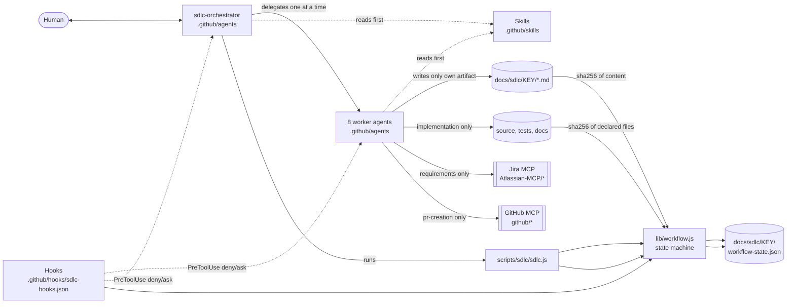
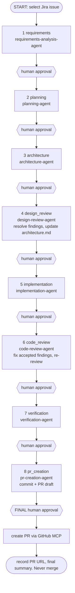
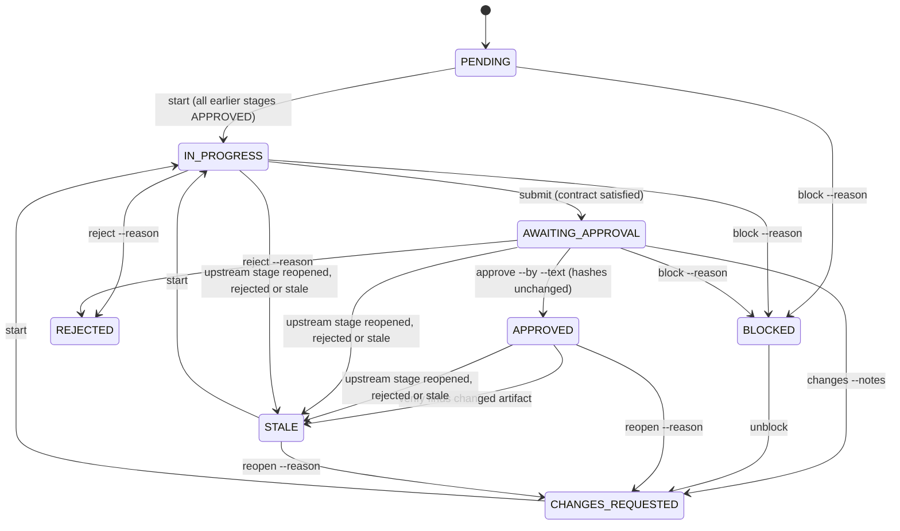
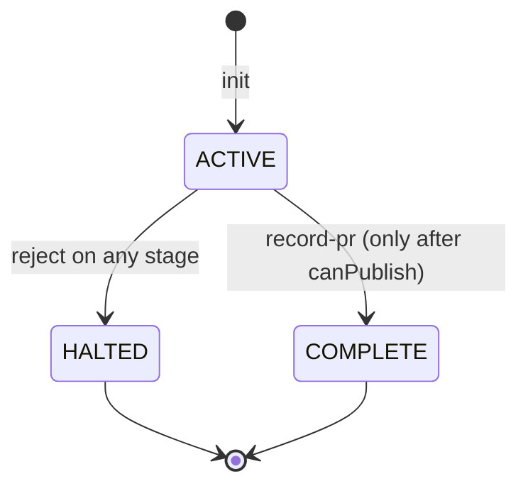

# Agentic SDLC Architecture

This repository hosts a human-governed Agentic SDLC for the use case **Automated Documentation Sync** (sample story: `docs/sdlc/DOC-SYNC-001/user-story.md`). One orchestrator agent coordinates eight specialist worker agents from requirements to a prepared pull request. Every stage ends at a human approval gate.

Related documents: [agent-responsibilities](agent-responsibilities.md), [human-approval-workflow](human-approval-workflow.md), [agent-skill-hook-mapping](agent-skill-hook-mapping.md), [workflow-execution-guide](workflow-execution-guide.md), [commit-and-pr-conventions](commit-and-pr-conventions.md).

## 1. Goals

- Run the SDLC as a state-driven workflow, not eight unrelated chat personas.
- Make approvals explicit, attributable to a named human, and bound to the exact artifact content that was approved.
- Prevent a downstream stage from starting before its prerequisites are approved.
- Make it impossible, through the workflow, to publish a PR without fresh final approval, and impossible to merge at all. Merging to `main` stays a later, human-only action in GitHub, outside this pipeline.
- Keep evidence honest: no fabricated test results, approvals, commit hashes, CI links or PR numbers.

## 2. Components



| Layer | Files | Role |
| --- | --- | --- |
| Instructions | `.github/copilot-instructions.md`, `.github/instructions/*.instructions.md` | Shared and scoped rules for all agents |
| Agents | `.github/agents/*.agent.md` (1 orchestrator + 8 workers) | Role, inputs, outputs, forbidden actions, handoff |
| Skills | `.github/skills/*/SKILL.md` (9) | Reusable procedures; agents are told to read their skill first |
| State machine | `scripts/sdlc/lib/workflow.js`, `lib/stages.js`, `lib/store.js` | Stage order, contracts, approvals, staleness, publish gate |
| CLI | `scripts/sdlc/sdlc.js` | The only way the orchestrator changes state |
| Hooks | `.github/hooks/sdlc-hooks.json`, `scripts/sdlc/hooks/*.js` | Tool-boundary enforcement and audit |
| Feature | `scripts/doc_sync/` | The Automated Documentation Sync tool being built and demonstrated |

## 3. Stage flow



The ids `requirements, planning, architecture, design_review, implementation, code_review, verification, pr_creation` and each stage's agent, skill, artifacts and required sections are defined once in `scripts/sdlc/lib/stages.js`. `tests/sdlc/assets.test.js` checks the agents, skills and docs against that file.

## 4. Stage state machine



Run status (`state.status`):



A HALTED run accepts no further stage commands. To start over, move that run's `workflow-state.json` aside and run `init` again (`init` refuses to overwrite an existing run).

## 5. Trust and data boundaries

| Actor | May | May not |
| --- | --- | --- |
| Human | Approve, request changes, reject, stop | n/a |
| `sdlc-orchestrator` | Delegate to workers; run `scripts/sdlc/sdlc.js`; read and search; execute commands | Edit files (no `edit` tool); write artifacts; approve without a human reply; merge |
| Worker agents | Write their own artifact (implementation also code and tests) | Run `start`, `submit`, `approve`; approve their own work; create PRs; merge |
| `requirements-analysis-agent` | Read Jira via `Atlassian-MCP/*` | Modify Jira |
| `pr-creation-agent` | Commit approved files; after final approval push and create the PR via `github/*` | Merge; force-push; publish before `can-publish` passes |
| Hooks | Deny or ask before a tool call; log; report doc drift | Approve, publish, merge, or change workflow state |
| Scripts | Compute hashes, validate contracts, store decisions | Contact Jira or GitHub |

Credentials never enter the state file, artifacts, the audit log or PR text. The state store refuses to track `.env*`, `*.pem`, `*.key`, `*.p12`, `*.pfx` and any `mcp.json`, and refuses paths that escape the repository.

## 6. Workflow state

Location: `docs/sdlc/<ISSUE-KEY>/workflow-state.json` (gitignored; see [commit-and-pr-conventions](commit-and-pr-conventions.md)). Written only by `scripts/sdlc/sdlc.js`, using a lock file (`workflow-state.json.lock`, stale after 30 s), an atomic temp-file rename, and an optimistic `revision` check so a concurrent writer gets `CONFLICT` instead of silently overwriting. A corrupt file yields `CORRUPT_STATE` and is left untouched.

```json
{
  "schemaVersion": 1,
  "runId": "DOC-1-20261013120000-ab12cd",
  "issueKey": "DOC-1",
  "source": { "type": "jira | pasted", "url": "required for jira, else null" },
  "status": "ACTIVE | HALTED | COMPLETE",
  "revision": 12,
  "createdAt": "ISO-8601", "updatedAt": "ISO-8601",
  "stages": {
    "requirements": {
      "status": "APPROVED",
      "attempts": 1,
      "hashes": { "docs/sdlc/DOC-1/requirements.md": "sha256..." },
      "approvedHashes": { "docs/sdlc/DOC-1/requirements.md": "sha256..." },
      "approval": { "by": "name", "decisionText": "verbatim reply", "at": "ISO-8601", "attempt": 1 },
      "evidence": [ { "at": "ISO-8601", "attempt": 1, "text": "..." } ],
      "blocker": null,
      "notes": null
    }
  },
  "commit": { "sha": "real hex id", "message": "...", "at": "ISO-8601" },
  "pr": { "url": "https://github.com/<owner>/<repo>/pull/<n>", "number": 0, "at": "ISO-8601", "merged": false },
  "events": [ { "at": "ISO-8601", "type": "STAGE_APPROVED", "stage": "requirements", "detail": "by name" } ]
}
```

`stages` contains all eight stage ids. `commit` and `pr` are `null` until recorded.

### Hash-bound approvals

- `submit` hashes (SHA-256, CRLF normalized to LF so Windows line endings do not matter) each stage artifact plus any declared source files, and stores them in `hashes`.
- `approve` re-hashes. If anything changed since `submit`, it fails with `STALE`; the worker output must be resubmitted and the human asked again.
- On approval, `hashes` is copied to `approvedHashes`. `verify` (and `can-publish`) re-hash every approved stage; a mismatch marks that stage and every later non-pending stage `STALE` and clears their approvals.
- Approval requires `--by` and the human's verbatim `--text`; both are stored.

### Tracked source files

- `implementation` tracks the files declared with `submit --files a,b`.
- `code_review` inherits the implementation file list, `verification` inherits from `code_review`, `pr_creation` inherits from `verification`. Each inherits the list from the parent's approved hashes plus any new `--files`.

### Rebaseline rule

Some stages legitimately change an earlier stage's files: design review resolutions edit `architecture.md`; code-review fixes and verification test additions edit implementation files. When such a stage is submitted (`design_review` rebases `architecture`; `code_review` rebases `implementation`; `verification` rebases `code_review` and `implementation`), the earlier stage's recorded hash for each overlapping path is updated and a `REBASELINE_PROPOSED` event is logged. The new hash is trusted only through the human's approval of the later stage. If that stage is not approved, the run does not proceed.

### Freeze rule

`pr_creation` has no rebase target. At `submit`, every inherited file must still match `verification`'s approved hash, otherwise `submit` fails with `STALE` ("verification must be repeated"). Nothing may change between verification approval and PR preparation without redoing verification.

### Branch model and merge boundary

Target repository: `shivkantkumar098/aimitra` (the existing `origin`; no other remote). Every change gets its own branch `<ISSUE-KEY>/<feature-name>` (lowercase kebab-case, 3-50 chars), created from up-to-date `main` before `implementation` starts (`suggest-branch`, `git switch -c`, `check-branch`); the branch for this work is `DOC-SYNC-001/documentation-sync`. `start implementation` records the branch in state; later stages and `can-publish` require HEAD to still be on it. All commits land on that branch, and only `pr-creation-agent` commits. After final approval the branch is pushed with `git push -u origin <ISSUE-KEY>/<feature-name>` (the GitHub MCP cannot push local commits; the push is hook-gated), then `create_pull_request` is called with owner `shivkantkumar098`, repo `aimitra`, head = the feature branch, base `main`. The workflow ends at "PR URL reported". Merging to `main` is a later, human-only action in GitHub by someone with merge rights, outside this pipeline.

### Publish gate (`canPublish`)

Publishing is allowed only if the run is `ACTIVE`, all eight stages (including the final `pr_creation` approval) are `APPROVED` with a recorded approval, and every approved hash still matches the files on disk. `record-pr` re-checks this, requires a `https://github.com/<owner>/<repo>/pull/<n>` URL, sets the run `COMPLETE` and records `merged: false`. No function in the workflow or store code merges anything; `tests/sdlc/workflow.test.js` asserts no exported name contains "merge".

## 7. Enforcement layers

| Layer | Mechanism | Enforced or advisory |
| --- | --- | --- |
| Instructions, agent bodies, skills | Natural-language rules the model is asked to follow | Advisory. A model can ignore them. |
| State machine and CLI | `workflow.js` throws `WorkflowError` for out-of-order starts, missing approval text, stale hashes, contract failures, rejected runs, premature `record-pr` | Enforced, but only for actions that go through the CLI |
| Hooks | `PreToolUse` deny or ask on secrets, merges, force-push, destructive git, state-file edits, push and PR creation without the gate, approvals; branch convention (`<ISSUE-KEY>/<feature-name>`, never `main`, only `origin`), and PR owner/repo (`shivkantkumar098/aimitra`), head (recorded feature branch) and base (`main`) | Enforced only in a client that runs the hooks (see limitations) |
| Human | Confirms `ask` prompts; gives every approval | The final authority |

## 8. Design decisions and alternatives

| Decision | Why | Alternative considered |
| --- | --- | --- |
| Pure state machine with injected file-system `env`, in Node with no dependencies | Unit-testable with an in-memory fake; Node was already used for the previous hook; no new install | Python; a database; storing state in Jira |
| Hash-bound approvals | Prevents a changed artifact from silently inheriting an earlier approval | Timestamps only; trusting file mtime |
| One artifact owner per file (architecture.md may be revised by design review via the architecture agent) | Avoids conflicting responsibilities; checked by `assets.test.js` | Shared ownership |
| Orchestrator has no `edit` tool | It can coordinate but cannot write artifacts or code | Orchestrator writes artifacts |
| State and PR draft are gitignored, other artifacts committed | The draft cites the commit it would otherwise be part of; state embeds pre-final approvals | Commit everything |
| Doc sync as stdlib Python using `ast` | Matches the FastAPI backend; no dependencies | Regex over source; LLM-written docs |
| Hooks configured in one VS Code format file | One source of truth, no duplicate execution | A second Copilot CLI file |

## 9. Limitations (read before relying on this)

1. **Agent and instruction compliance is advisory.** Only the CLI state machine and hooks enforce rules, and only for the paths that pass through them.
2. **Hooks only run in clients that support them.** `.github/hooks/sdlc-hooks.json` uses PascalCase VS Code agent-hook events (`PreToolUse`, `PostToolUse`, `SubagentStart`, `SubagentStop`). The Copilot CLI uses a different schema and is **not** configured. If the client does not execute these hooks, the secret, merge and publish protections described here do not apply.
3. **Unverified Copilot formats.** The authoring environment could not query your installed Copilot/VS Code version, and the workflow has not yet been run in Copilot Agent Mode. The agent frontmatter, hook event names, the hook stdin payload and decision output (`permissionDecision` allow/deny/ask, exit code 2 to block; the scripts also accept the Copilot CLI `toolName`/`toolArgs` payload shape) and the MCP tool references `Atlassian-MCP/*` and `github/*` follow the documented formats as understood, but could not be verified against your installed Copilot/VS Code version. Check them against your version's documentation and your actual MCP server names (the template `.github/mcp.example.json` names the servers `github` and `Atlassian-MCP`; the GitHub header `X-MCP-Toolsets` is also unverified). The remote GitHub MCP server creates branches/files/PRs through the API but cannot push local commits, so the branch is pushed with `git push -u origin <ISSUE-KEY>/<feature-name>` (hook-gated) before `create_pull_request`. The branch-name, remote and PR owner/repo/head/base checks are hook-level and, like all hooks, apply only where the client runs them.
4. **Not exercised against real MCP servers.** The automated tests use temp directories and fake payloads (marked SIMULATED). No real Jira retrieval, GitHub push or PR creation has been performed by this work.
5. **An agent could run `approve` itself.** The CLI cannot tell a human from an agent. The mitigations are the required verbatim `--text`, the audit log, and `block-unsafe-ops`, which returns an `ask` decision for every `sdlc.js approve` so the human must confirm in the client UI. If hooks do not run (limitation 2), that confirmation does not happen.
6. **Worker file scope is not machine-enforced.** Workers have an `edit` tool; "write only your own artifact" is advisory. Hash tracking detects changes to tracked files only.
7. **Single-user local state.** Locking handles concurrent CLI calls on one machine, not multiple clones.
8. **Credentials in `.vscode/mcp.json`.** The working-tree `.vscode/mcp.json` contains a plaintext Jira API token and account email. They were exposed in the authoring session transcript. The file is gitignored (not in Git), but the token must be **revoked** (id.atlassian.com, Security, API tokens) and a new one created. The automated edit of this credentials file was refused, so you must apply it yourself. The simplest fix is to copy the credential-free template `.github/mcp.example.json` over `.vscode/mcp.json` (it also adds the `github` server). Equivalent Jira-only content, keeping your own site URL:

   ```json
   {
     "servers": {
       "Atlassian-MCP": {
         "command": "uvx",
         "args": ["--python", "3.13", "mcp-atlassian"],
         "env": {
           "JIRA_URL": "https://<your-site>.atlassian.net/",
           "JIRA_USERNAME": "${input:jira-username}",
           "JIRA_API_TOKEN": "${input:jira-api-token}"
         }
       }
     },
     "inputs": [
       { "type": "promptString", "id": "jira-username", "description": "Atlassian account email" },
       { "type": "promptString", "id": "jira-api-token", "description": "Jira API token", "password": true }
     ]
   }
   ```
