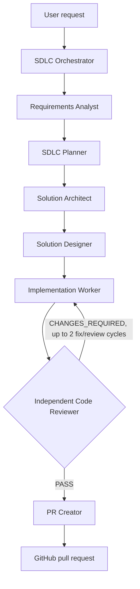

# Copilot SDLC Agent Workflow

Invoke **SDLC Orchestrator** from the Copilot agent picker for an end-to-end change. The orchestrator delegates to one specialist at a time and passes each handoff forward.

## Stage handoffs

| Order | Agent | Output |
| --- | --- | --- |
| 1 | Requirements Analyst | Scope, constraints, acceptance criteria, assumptions, blockers |
| 2 | SDLC Planner | Dependency-ordered tasks and validation plan |
| 3 | Solution Architect | Affected components, flow/contracts, decisions, risks |
| 4 | Solution Designer | User/API behavior, states, edge cases, accessibility |
| 5 | Implementation Worker | Focused code changes and exact check results |
| 6 | Code Reviewer | Severity-ranked findings and `PASS` / `CHANGES_REQUIRED` |
| 7 | PR Creator | PR URL and summary, only after review passes |

Each agent has a matching on-demand skill in `.github/skills/` and an agent-scoped `SessionStart` hook in `.github/hooks/sdlc-context.js`. The orchestrator also receives a `SubagentStop` reminder to collect each worker's handoff.

## Safety and validation

- Blocking requirement ambiguity pauses the pipeline for user input.
- Analysis stages do not edit code; implementation does not commit or push.
- Review is read-only and independent. Unresolved findings stop PR creation.
- The PR worker must verify branch/worktree state and stage only task-specific reviewed changes. It must stop for user input if changes cannot be isolated or publishing would require an unsafe assumption.
- Run the narrowest applicable project checks. The documented frontend build is `npm run build` in `frontend/`; Python-only changes can use `python -m compileall backend`. No frontend test script is currently configured.
- Hooks provide concise stage context; they do not edit files, commit, push, or create PRs.
