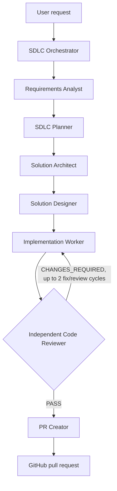

> **Superseded.** The 7-agent flow described below (Requirements Analyst through PR Creator, with agent-scoped hooks and no approval gates) was replaced by the `sdlc-orchestrator` plus eight worker agents with mandatory human approval at every stage. See [agentic-sdlc-architecture](../agentic-sdlc-architecture.md), [workflow-execution-guide](../workflow-execution-guide.md) and [human-approval-workflow](../human-approval-workflow.md). The text below is kept for history and no longer matches `.github/`.

# Copilot SDLC Agent Workflow

Invoke **SDLC Orchestrator** from the Copilot agent picker for an end-to-end change. The orchestrator delegates to one specialist at a time and passes each handoff forward. In Copilot surfaces that expose project skills as slash commands, you can also invoke `/sdlc-workflow`; otherwise, select the orchestrator in the agent picker. No special prompt syntax or fixed input schema is required.

## How to invoke it

Select **SDLC Orchestrator** in the agent picker (or enter `/sdlc-workflow` where project skill commands are available), then describe the change you want in natural language. Include as much of the following context as is relevant:

- **Goal or request:** what should change and why.
- **Constraints and context:** important product, technical, or process constraints; relevant files, folders, or systems to inspect.
- **Acceptance criteria:** observable outcomes that will show the request is complete.
- **Validation and delivery expectations:** checks to run and whether a pull request is desired.

You do not need to supply every item or use a particular format. The workflow will clarify blocking gaps with you rather than guess.

For example:

> Use the SDLC workflow to add [describe the change]. Context: [relevant files or background]. Constraints: [constraints]. It is done when [acceptance criteria]. Run [validation expectations]. Please pause and ask me if any blocking requirement is ambiguous; if it is clear, carry the request through independent review and create a pull request only if the review passes and it is safe to do so.

## What it returns

Each specialist produces a handoff for the next stage; the outputs are summarized below. The orchestrator reports stage progress and the resulting handoffs, including implementation changes and exact validation results. The independent reviewer returns either `PASS` or actionable `CHANGES_REQUIRED` findings. A PR URL and summary are produced only when review is `PASS`, a PR was requested, and the PR worker can safely proceed. If a requirement is blocking or unsafe to assume, the workflow pauses for your input instead of continuing.

## Stage handoffs

| Order | Agent | Output |
| --- | --- | --- |
| 1 | Requirements Analyst | Scope, constraints, acceptance criteria, assumptions, blockers |
| 2 | SDLC Planner | Dependency-ordered tasks and validation plan |
| 3 | Solution Architect | Affected components, flow/contracts, decisions, risks |
| 4 | Solution Designer | User/API behavior, states, edge cases, accessibility |
| 5 | Implementation Worker | Focused code changes and exact check results |
| 6 | Code Reviewer | Severity-ranked findings and `PASS` / `CHANGES_REQUIRED` |
| 7 | PR Creator | PR URL and summary, only after review passes and safe worktree/branch verification |

Each agent has a matching on-demand skill in `.github/skills/` and an agent-scoped `SessionStart` hook in `.github/hooks/sdlc-context.js`. The orchestrator also receives a `SubagentStop` reminder to collect each worker's handoff.

## Safety and validation

- Blocking requirement ambiguity pauses the pipeline for user input.
- Analysis stages do not edit code; implementation does not commit or push.
- Review is read-only and independent. Unresolved findings stop PR creation.
- The PR worker must verify branch/worktree state and stage only task-specific reviewed changes. It must stop for user input if changes cannot be isolated or publishing would require an unsafe assumption.
- Run the narrowest applicable project checks. The documented frontend build is `npm run build` in `frontend/`; Python-only changes can use `python -m compileall backend`. No frontend test script is currently configured.
- Hooks provide concise stage context; they do not edit files, commit, push, or create PRs.
